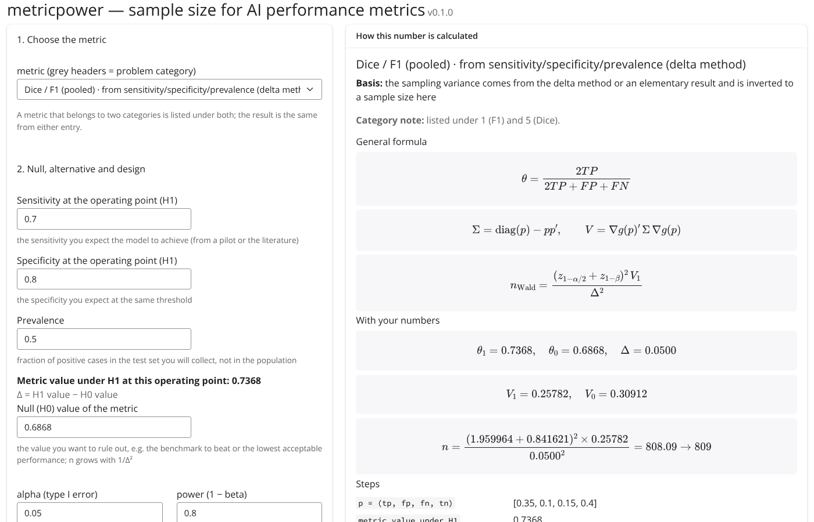

# metricpower

**A priori sample size and power for the performance metrics used to evaluate AI/ML
models** — Dice, IoU, MCC, sensitivity, AUC, kappa, Brier, false positives per image
and ~70 more. Three ways to use it:

| | | |
|---|---|---|
| **Shiny app** (v0.1.1) | point-and-click: pick the metric, enter H0 / H1 / α / power, read n — and see the formula with your numbers and the reference | [`app.py`](app.py) — run locally in one command (below) |
| **Python package** `metricpower` 0.1.1 | the same calculations as functions; ships the app | this repository root |
| **R package** `metricpower` 0.1.2 | the original implementation; identical numbers | [`r-package/`](r-package/) |

## The Shiny app



```bash
pip install "metricpower[app] @ git+https://github.com/wth12380-alt/metricpower.git"
shiny run app.py            # or: python -m metricpower.app   → open http://127.0.0.1:8000
```

or from a clone: `pip install -e ".[app]"` then `shiny run app.py`.

**Left panel** — pick the metric from a drop-down whose grey headers are the problem
categories (confusion-matrix classification, precision–recall and ranking, ROC/AUC,
calibration, segmentation and overlap, distance/geometry, regression error,
correlation/agreement/reliability, information theory, fairness/survival/decision/NLP/
readability, image quality); a metric that belongs to two categories is listed under
both. Enter the operating point or pilot values that define H1, the null value, alpha,
power and (optionally) the clustering design effect. Where Wald and score conventions
give different n, the recommended one is marked and the difference explained.
**Right panel** — the general formula, the same formula with your numbers substituted
(z-values to six decimals), every intermediate quantity, the caveats to read before
trusting the number, and the reference. Formulas render with a bundled copy of MathJax,
so the app works offline. Only metrics that can be sized a priori appear in the app.

Hosted version: [[not yet deployed — `rsconnect deploy shiny . --name <account> --title metricpower`]]

## The R package

```r
remotes::install_github("wth12380-alt/metricpower", subdir = "r-package")
library(metricpower)
p <- cell_prob_from_operating_point(sensitivity = 0.70, specificity = 0.80, prevalence = 0.50)
n_for_power_l3("dsc_f1", p = p, delta = 0.05)$n     # 810
```

See [`r-package/README.md`](r-package/README.md) for the full R interface and
[`r-package/inst/validation/`](r-package/inst/validation/) for the R validation scripts
(`validate_all.R`, `operating_characteristics.R`).

## The Python package

## The one idea

Every metric is put in one of three groups by what the statistics allow:

| Group | Meaning | What the package does |
|---|---|---|
| **A** | An established formula already exists and is implemented in an R package (presize, MKpower, pROC, kappaSize, ICC.Sample.Size, pmvalsampsize, powerSurvEpi, …) | Those packages have no Python versions, so the underlying published formulas are **implemented natively** here, each labelled with its reference and with how it differs from the R routine |
| **B** | The sampling variance is published or elementary, but nothing inverts it to a sample size | **Implemented** through one delta-method engine plus four further estimator families; 47 metrics |
| **C** | No analytic variance exists (Hausdorff distance, average precision, ECE, BLEU, …) | **Refused with the reason**; these can only be bootstrapped after data collection |

For a confusion-matrix metric the engine is three lines of mathematics:

```
p  = (tp, fp, fn, tn)                 cell probabilities at the assumed operating point
V  = ∇g(p)' [diag(p) − pp'] ∇g(p)     multivariate delta method on the multinomial
n  = (z_{1−α/2} + z_{1−β})² V / Δ²    standard inversion to a sample size
```

## Install

```bash
pip install git+https://github.com/wth12380-alt/metricpower.git        # package only
pip install "metricpower[app] @ git+https://github.com/wth12380-alt/metricpower.git"   # with the Shiny app
```

or from a clone:

```bash
git clone https://github.com/wth12380-alt/metricpower.git
cd metricpower
pip install -e ".[dev]"
```

## Use

```python
import metricpower as mp

# Group B: a confusion-matrix metric at an assumed operating point
p = mp.cell_prob_from_operating_point(sensitivity=0.70, specificity=0.80, prevalence=0.50)
r = mp.n_for_power_group_b("dsc_f1", p=p, delta=0.05)      # detect a 0.05 drop in Dice, 80% power
r.n                      # 810
r.extra["n_score"]       # 921  (score-test convention; use the one matching your analysis)
print(r.formula_numeric) # the formula with the numbers substituted
print(r.references_full())

mp.n_for_power_group_b("mcc", p=p, delta=0.05).n                                  # 2323
mp.n_for_power_group_b("macro_f1", P=[[.30,.04,.02],[.05,.22,.05],[.03,.06,.23]], delta=0.05).n   # 594
mp.n_for_power_group_b("fppi", lam=0.5, ratio=0.7, theta=2).n                     # 155 images
mp.n_for_power_group_b("brier", mean=0.15, sd=0.15, delta=0.02).n                 # per-case mean

# Group A: natively ported formulas
mp.n_for_power_group_a("auroc", auc1=0.80, auc0=0.70).n                           # Hanley–McNeil
mp.n_for_power_group_a("sensitivity", value1=0.85, value0=0.75, prevalence=0.30).n  # Buderer
mp.n_for_power_group_a("kappa_unweighted", kappa1=0.6, kappa0=0.4, marginals=[.3,.7]).n
mp.n_for_power_group_a("calibration_slope", lp_mean=-1.5, lp_sd=1.2, halfwidth=0.1).n  # Riley 2021

# Group C: why there is no number
mp.explain_group_c("hausdorff_distance").notes

# design extras
mp.design_effect(m_bar=3, icc=0.30)                 # 1.6: multiply n for clustered lesions
mp.delta_var_paired(p8, "dsc_f1")                   # two models on the same cases (8-cell joint)
mp.check_delta_reliable(p, "dsc_f1", n=60)          # is the delta method trustworthy at this n?
```

Every `Result` carries `n`, `estimate`, `null_value`, `V_alt`, `V_null`,
`steps`, `formula_latex`, `formula_numeric`, `reference` and `notes`.

## Experimental: a delta-method variance for corpus BLEU

`metricpower/bleu.py` derives an analytic variance for corpus BLEU (it is a smooth
function of ten per-segment means) and validates it against Monte Carlo and the
bootstrap (`validation/validate_bleu.py`). It is **not** wired into the dispatcher
or the app yet; BLEU stays listed among the metrics without an a priori sample size
until the derivation has been reviewed.

## Check it yourself

```bash
pytest                                            # 71 unit tests, ~5 s; reproduce the R package's numbers
python validation/validate_all.py                 # 85-variance Monte Carlo validation, 10 000 replicates (~30 s)
python validation/operating_characteristics.py    # type I error and power at the calculated n, every metric (~20 min)
bash scripts/check.sh                             # tests + validation + an app smoke test
```

`validation/validation_output.txt` and `validation/operating_characteristics.txt` are the tables from the last full runs.


## Cross-check with R

The same inputs in both packages (sensitivity 0.70, specificity 0.80, prevalence 0.50, Δ = 0.05, α = 0.05 two-sided, power 0.80):

| metric | R `n_for_power_l3()` | Python `n_for_power_group_b()` |
|---|---|---|
| accuracy | 589 | 589 |
| balanced accuracy | 581 | 581 |
| Dice / F1 (Wald / score) | 810 / 921 | 810 / 921 |
| specificity | 1005 | 1005 |
| IoU | 1272 | 1272 |
| sensitivity | 1319 | 1319 |
| MCC | 2323 | 2323 |
| macro-F1 (3 × 3 table) | 594 | 594 |
| weighted kappa | 1245 | 1245 |
| FPPI Poisson / NB(θ=2) | 124 / 155 | 124 / 155 |
| risk difference | 341 | 341 |
| paired Dice, V | 0.2021 | 0.2021 |

`scripts/crosscheck.R` prints the R column; `scripts/crosscheck.py` prints the Python column.

## What the operating-characteristics simulation showed (and what changed because of it)

`validation/operating_characteristics.py` draws data at the planning operating point for every
implemented variance and checks the empirical type I error and power at the n the package returns
(10,000 replicates; `validation/operating_characteristics.txt`). Three findings shaped the package:

- **Per-case means are sized with the t-test.** With the sample SD as the SE, the z critical value
  inflates the type I error at small n (0.12 at n = 5, 0.07 at n = 15). Per-case metrics therefore
  use the noncentral-t sample size (`n_for_power_t`, as R's `power.t.test`) and the `t_{n-1}` critical
  value; the z-based n is kept in `Result.extra["n_z"]`. What remains after that is skewness.
- **Confusion-matrix metrics: the score n is recommended.** At the Wald n, power fell to 0.77–0.79 for
  metrics whose variance is larger under H0 than under H1 (specificity, Dice, PPV, macro-F1); at the
  score n it was 0.79–0.81 for every metric. The app now marks the score n as recommended where the
  null operating point is reachable, and falls back to Wald with a note where it is not.
- **Volumetric similarity has a kink at fp = fn.** Within ~3 SE of it the delta-method variance is too
  large (−17% at 1.6 SE; the test is conservative). `kink_distance()` measures it and
  `n_for_power_metric()` warns.

## What to know before trusting a number

- **Δ has no default.** With a standardised Δ every metric needs the same n (V cancels); with a relative Δ the ranking across metrics is a ranking of coefficients of variation. Choose Δ on clinical grounds.
- **The delta method needs n of roughly 250.** Below that it understates the variance (up to ~10% for Dice at n = 25), always optimistically. `check_delta_reliable()` quantifies it.
- **Per-case metrics fail through skew, not sample size.** Their variance is exact; what degrades is the normal approximation. Per-case Dice is left-skewed, so its intervals sit above the truth.
- **Group A ports are formula-level, not package-level.** Where the R package uses a different route (MKpower's exact binomial, kappaSize's goodness-of-fit statistic, pROC's binormal variance), the `notes` say so.
- **FROC/AFROC and partial AUC are not ported** — they need pilot variance components (RJafroc) or binormal parameters (pROC); the package returns the R call to run.

## Layout

```
r-package/        the R package (DESCRIPTION, R/, inst/validation/, bundled tarball)
app.py            Shiny entry point
src/metricpower/
  core.py         engine: cell probabilities, delta method, 21 confusion-matrix metrics with gradients,
                  n/power/precision, paired comparison, clustering, small-sample checks, weighted kappa
  families.py     multiclass, count rate, 44 per-case metrics, entropy, CV, U-statistics, R², repeatability,
                  two-group and paired differences
  groupb.py       dispatcher n_for_power_group_b() and the family manifest
  groupa.py       native ports of the Group A formulas + registry with the R equivalents
  groupc.py       the refused metrics and why
  references.py   citations used by every Result
  app/            Shiny for Python app (specs.py = inputs per metric, app.py = UI/server)
tests/            pytest suite
validation/       Monte Carlo validation script and its last output
scripts/          check.sh, crosscheck.py, crosscheck.R
```

## License

MIT.
